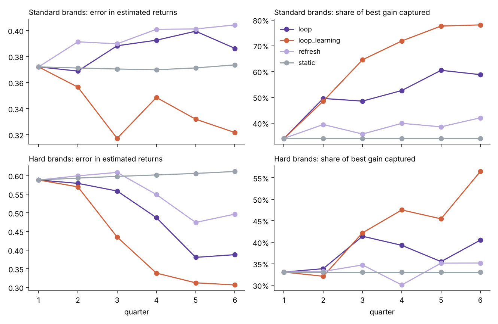

<p align="center">
  
</p>

# Papilon

<p align="center">
  
  
  
</p>

<p align="center"><em>"Does the flap of a butterfly's wings in Brazil set off a tornado in Texas?" Edward Lorenz</em></p>

Papilon (French for butterfly) is a Bayesian marketing mix modeling framework you can
check. It chooses each channel's carryover and saturation form by Bayes factor, reports
when its posterior can't be trusted and falls back to a stronger sampler, plans budgets
for the case where it is wrong, and is graded in public against simulated brands with
known returns.

Version 1.0 is a production release. It adds regional models with partial pooling,
Weibull carryover, logistic and S-shaped curves, effects that change over time, reach and
frequency, organic channels, lift tests calibrated on the weeks they ran, forward
forecasts and scenarios, causal discovery, and the **learning loop**: a refresh cycle that
recommends the experiment worth the most to the budget plan, separates channels the model
cannot tell apart with a small budget-neutral pulse, and is itself graded quarter by
quarter against known truth. Around the model: data checks, warehouse loaders, saved
models that open without Papilon, MLflow logging, drift monitoring, HTML reports, CI on
three operating systems and a stable API.

Documentation: [guides and API reference](docs/index.md).

## Install

```bash
pip install papilon                        # core
pip install "papilon[mlflow,snowflake,mcp]"   # optional: tracking, warehouse, AI assistants
```

## What 1.0 covers

| Area | Capability |
|---|---|
| Model forms | geometric, delayed and Weibull carryover; Hill, S-curve and logistic saturation; time-varying effects; baseline drift; chosen per channel by Bayes factor |
| Inputs | paid media, reach and frequency, organic channels, controls with their own contributions |
| Calibration | lift tests in the likelihood on the weeks they ran; return priors |
| Regions | `GeoMMM`: shared curves, regional effects pooled toward a common effect, integrated exactly |
| Inference | importance sampling with a quality gate, mixture proposals over all modes, tempered SMC fallback |
| Checking | backtest, self-check on simulated copies of the brand, confounding stress test, open leaderboard |
| Planning | downside-protected plans, plan stability and bagging, forward forecasts, paired scenarios |
| Learning | `Loop`: refresh, score, recommend the most valuable test, explore between indistinguishable channels |
| Structure | knowledge graph with audit, back-door identification, PC causal discovery against the data |
| Production | data checks, SQL, Snowflake and BigQuery loaders, save and load without pickles, MLflow, drift monitoring, HTML reports, AI tools and an MCP server |
| Stability | semantic versioning, API snapshot test, deprecation policy, CI on Linux, Windows and macOS |

## Quickstart: a marketing mix model with a known truth

`make_synthetic_mmm()` creates three years of weekly sales for a brand running four
digital channels, and returns the parameters that generated it, so you can check every
estimate against the truth.

```python
import papilon as pp

df, truth = pp.make_synthetic_mmm()

model = pp.MMM(
    data=df,
    target="sales",
    media=["paid_search", "paid_social", "online_video", "display"],
    date_col="date",
    controls=["price_index", "promo"],
    yearly_seasonality=2,
    seed=11,
)

# Does online video's effect peak after the week it runs? Let the data decide.
families = model.compare_carryover({
    "all_geometric": [],
    "video_delayed": ["online_video"],
})

roi = model.get_roi()                                   # ROAS with 90% intervals
plan = model.optimize_budget(total=df[model.media].sum(axis=1).mean())
plan.attrs["summary"]   # expected gain, 90% interval, chance it beats the current mix
```

Output from `examples/mmm_quickstart.py`, abridged (spend and sales in $ thousands):

```
               log_evidence  log_bayes_factor_vs_best  probability  ess_fraction verdict
all_geometric       242.639                   -20.991          0.0         0.146  ACCEPT
video_delayed       263.629                     0.000          1.0         0.140  ACCEPT

                spend  roas_mean  roas_p05  roas_p95  mroas_mean  true_roas
paid_search   4729.95       0.65      0.04      1.76        0.30       1.25
paid_social   7678.08       0.95      0.42      1.68        0.47       1.50
online_video  7369.53       1.75      1.50      2.02        0.86       1.57
display       3497.10       0.63      0.04      1.54        0.31       0.74

              current_spend  optimal_spend  change_in_spend  outside_support
paid_search            30.3           20.7             -9.6            False
paid_social            49.2           43.5             -5.7            False
online_video           47.2           70.9             23.6             True
display                22.4           14.1             -8.3            False
```

The model picks the delayed carryover shape for online video and puts its peak at 2.0
weeks, the true value. Every true ROAS falls inside its 90% interval. The point
estimates for paid search and paid social are low: search spend in this dataset follows
seasonal demand, which makes it hard to separate from seasonality with three years of
weekly data. That is the job lift tests do: pass a measured return as
`roi_priors={"paid_search": (mean, sd)}` and the model is calibrated to it.

The plan moves $23,600 a week toward online video and flags that $70,900 a week is
more than the brand has sustained before. Against the true response curves it adds
$4,400 a week in sales, about 79% of the best possible reallocation ($5,600). The 0.3
optimizer, on the same fit, moves $38,000 for $800.

## The learning loop (new in 1.0)

A model refit every quarter on data shaped by its own plans can lock in its mistakes.
`pp.Loop` feeds back only new information: new periods, experiment results on the weeks
they ran, and a small budget-neutral pulse between the two channels the model can least
tell apart. Each cycle values every possible lift test by its expected gain to the plan
over a year, nets off the sales the holdout would give up, and recommends one only if it
pays for itself.

```python
loop = pp.Loop(history, "sales", media, "date", controls=controls, horizon=13)
cycle = loop.cycle()                                   # plan, weekly schedule, recommended test
cycle = loop.cycle(new_data=last_quarter, tests=[measured_test])
loop.history()
```

Graded against known truth over six quarters ([benchmarks/LOOP.md](benchmarks/LOOP.md)):
on standard brands the loop's plans captured 59% of the best available gain by quarter
six, against 42% for refitting each quarter and 34% for fitting once, at no net cost in
sales. On brands with launches the model cannot see, its error in estimated returns fell
from 0.59 to 0.39, against 0.50 for refitting alone. Testing every quarter learns faster
still (78% captured, error 0.31) and costs 0.3% to 0.5% of sales while it learns.

<p align="center"></p>

## Declare, check, decide (from 0.5)

```python
g = pp.MarketingGraph("sales")                                   # what you believe about the brand
g.channel("paid_search", stage="lower").channel("online_video", stage="upper")
g.driver("seasonality", ["paid_search", "sales"], modeled=True)  # search spend follows demand
g.event("launch", ["paid_search", "sales"])                      # no column: unobserved
g.mediates("online_video", "paid_search")                        # video lifts branded search
g.audit(df)             # paid_search: launch has no data, its return is not identified; run a lift test

model = g.build_model(df, date_col="date")                       # controls and priors from the graph
model.compare_carryover(g.carryover_candidates())
model.compare_models({"concave": {}, "video_s": {"s_curve": ["online_video"]}})   # curve shape by Bayes factor

model.backtest(13)                # forecast held-out weeks against a naive forecast
model.self_check(12)              # refit to simulated copies of this brand with known returns
model.self_check(12, confounded={"paid_search": 0.5})            # what an unmeasured driver would do
model.value_of_lift_test()        # which experiment is worth the most to the plan, in sales per week
```

**Knowledge graph.** `MarketingGraph` is a small ontology: channels with a funnel stage,
drivers, events and experiments, joined by `drives`, `sets_spend`, `mediates`,
`belongs_to` and `measured_by`. It compiles into model settings, names every estimate
that rests on a driver you declared but cannot measure, answers "what else moves if I
cut this?" (`what_moves()`), and exports to JSON-LD. Edges suggested by a language model
enter as `propose()` and are ignored until you `confirm()` them. The same graph feeds
`pycausalsim.futures.worlds_from_graph`, which simulates brands with that structure
and an answer key. A graph makes assumptions explicit; it does not make them true.

**Self-checks.** `self_check()` answers whether this model, with this data, could
recover returns like the ones it reports. `value_of_lift_test()` simulates each
possible lift test, updates the posterior by reweighting its draws, re-plans, and
reports the expected gain: on the bundled brand it ranks paid search first and online
video last in about a second.

**AI assistants.** `papilon.ai.ToolBox(model, graph=g)` exposes the model as tools with
JSON schemas in the layouts chat model APIs accept; every result carries the caveats that
apply to it, decided by fixed rules. `python -m papilon.mcp_server --data ...` serves
the same tools over the Model Context Protocol. Papilon calls no language model and
sends no data anywhere: the assistant writes sentences, the model supplies the numbers.

`examples/checkable_mmm.py` runs all of this in about a minute. The methods are
described in [RFC 002](docs/design/002-checkable-mmm.md).

Guides: [quickstart](docs/quickstart.md), [the knowledge graph](docs/knowledge-graph.md),
[checking the model](docs/checking.md), [AI assistants](docs/ai-assistants.md) and the
[marketing vocabulary](docs/vocabulary/README.md). The
[open leaderboard](benchmarks/LEADERBOARD.md) scores models on simulated brands with
known returns, and [anyone can enter one](benchmarks/SUBMITTING.md).

## What Papilon does not do yet

- **Very large models.** The sampler keeps the sampled dimension small (regional effects
  are integrated out exactly), which covers dozens of regions. A gradient-based sampler for
  hundreds of free parameters, such as regional curve shapes or product hierarchies, is
  planned as an optional backend.
- **In geo models:** time-varying effects, reach and frequency, organic channels, lift tests
  and forecasting. Fit a national model on summed data for those.
- **Mediated effects** are declared in the knowledge graph and audited, not estimated.

To grade any model, from any library, on the same simulated brands, wrap it as a function
and use `pycausalsim.futures.leaderboard`.

## Budget plans that hold up

A marketing mix model can have honest intervals and still produce a bad plan:
optimizing expected sales leans hardest on whichever channel the model overrates.
`benchmarks/recovery.py` grades Papilon on 120 simulated brands with known returns,
generated by [PyCausalSim](https://github.com/Bodhi8/pycausalsim)'s temporal causal
model (`pycausalsim.futures.marketing`). Half are standard; half add unobserved
product launches that raise search and social spend and demand together, and social
creative that wears out. Results, share of the best possible gain captured and share of
brands where the plan lost money:

| Setting | 0.3 rule (max expected, 0 to 3x), 0.4.0 fit | 0.4.0 default (10th percentile, within 50%) | 0.4.1 default |
|---|---|---|---|
| Standard brands | 32%, lost money 33% | 46%, lost money 7% | 43%, lost money 2% |
| Standard + lift test on paid search | 65%, 10% | 58%, 2% | 57%, 0% |
| Launches hidden from the model | -132%, 83% | 5%, 45% | 10%, 37% |
| Launch calendar as a control | 37%, 25% | 41%, 12% | 39%, 8% |
| Launch calendar + lift test | 56%, 17% | 50%, 8% | 48%, 8% |

The 0.4 default gives up a few points in the best cases to avoid the worst ones. Three
things matter more than the optimizer: put known events such as launches in
`controls`, calibrate the channels the data cannot separate from demand with lift
tests (`roi_priors`), and read `plan.attrs["summary"]["prob_better"]` before moving
money.

0.4.1 puts the prior on each channel's return on the ROAS scale. Before, every channel
shared one prior on its effect in units of mean sales, which handed small channels a
prior return of 4 to 10 and overrated display by about 0.5 on average. Display's
overstatement now averages +0.21 to +0.30 across the five settings, against +0.49 to
+0.66 in 0.4.0.

To play a plan forward week by week with carryover and the full posterior, hand
`model.posterior_curves()` to `pycausalsim.futures.media_plan_scm`.

1.0.0 leaves these results in place. On the [open leaderboard](benchmarks/LEADERBOARD.md)
(16 simulated brands per track), compared with 0.5:

| Track | 90% range holds the truth | Best gain captured | Plans that lost money |
|---|---|---|---|
| Standard | 95% → 98% | 51% → 48% | 0% → 0% |
| Hard (unobserved launches) | 67% → 69% | 27% → 29% | 31% → 31% |
| S-curve, shape chosen by the data | 81% → 81% | 38% → 37% | 0% → 0% |

Differences of a few points are within the noise of 16 brands. A least-squares
regression on adstocked spend, graded on the same standard brands, holds the truth 45%
of the time and its plans lose money for half of them. Brands with launches the model
cannot see remain the weak spot; the learning loop's tests are the remedy (see above).

## How the model is fit

`pp.MMM` follows the inference path in
[RFC 001, amortized structural inference](papilon-amortized-inference-design.md):

1. **Proposal.** A distribution over the media parameters (carryover, saturation,
   effect size). Since 0.3.0, a Laplace fit at the posterior mode stands in for the
   trained amortized network the RFC describes.
2. **Importance sampling** against the exact posterior. Baseline, trend, seasonality,
   controls and noise are integrated out in closed form, so sampling covers only the
   media parameters.
3. **Effective-sample-size gate.** If the proposal matches the posterior well, it is
   accepted. If not, it is refined from the weighted draws and tried again, or the fit
   is escalated. `model.gate_results` records every step.
4. **Bayes factors.** The same importance weights estimate each family's marginal
   likelihood, so `compare_carryover()` can choose between geometric and delayed
   adstock per channel.

Channel effects are constrained to be positive. The single-channel prototypes behind
this design, with their results, are in [`prototypes/`](prototypes/).

## Other tools (from 0.2.0)

```python
import papilon as pp

pp.shannon_entropy(values)                               # information content
pp.simulate_kde_scenarios(df, columns, n_samples=1000)   # scenario simulation
pp.analyze_relationships(df, target="sales")             # correlation and mutual information
pp.infer_causal_structure(df, threshold=0.01)            # pairwise dependency screen
pp.grid_search_optimize(df, feature_ranges, objective_fn, constraints)
```

`infer_causal_structure` tests each pair of variables for a significant linear
relationship. It is a screen for dependencies, not causal discovery: it does not orient
edges or adjust for confounders.

The notebook `Papilon_Marketing_Optimization_Workflow.ipynb` walks through these tools.

## Tests

```bash
pip install -e ".[dev]"
pytest -m "not slow"     # about three minutes
pytest                   # includes the full Bayes-factor recovery test, a few minutes
```

## Roadmap

These are planned and **not in the released package**:

- An optional gradient-based (NUTS) sampler for very large models
- The trained amortized network from RFC 001 as a proposal
- Geo models with time-varying effects, lift tests and forecasting
- Mediated effects estimated in the model, not only declared in the graph
- Published leaderboard entries for other open-source models on the same worlds

## License

Apache License 2.0, free for commercial use. See [LICENSE](LICENSE) and [NOTICE](NOTICE).

## Citation

If you use Papilon in research, please cite:

```
Curry, B. (2026). Papilon: Bayesian marketing mix modeling with gated importance
sampling (Version 1.0.0). https://github.com/Bodhi8/papilon
```

Built by [Brian Curry](https://vector1.ai), Vector1 Research. Papilon, PyCausalSim and
Vector1 are trademarks of Brian Curry. The license covers the code, not the names:
see [TRADEMARKS.md](TRADEMARKS.md).
